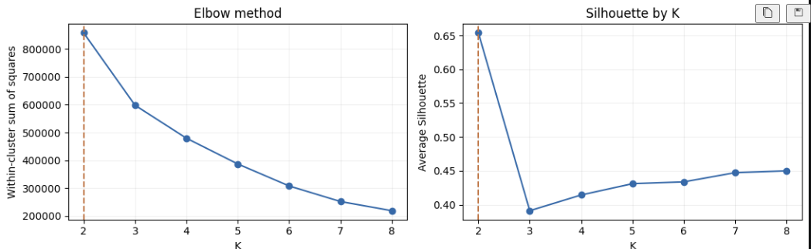
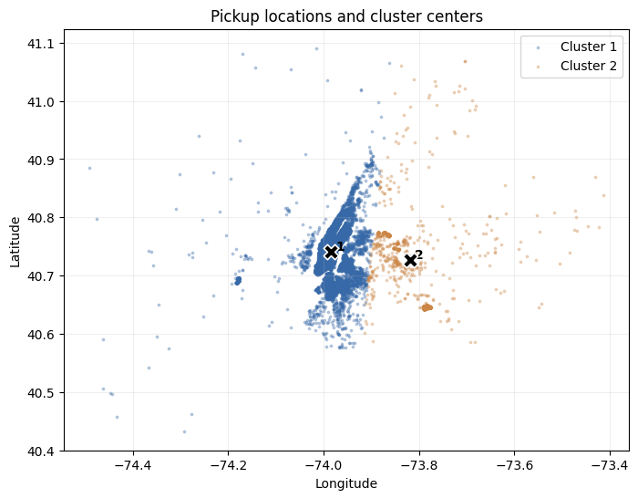
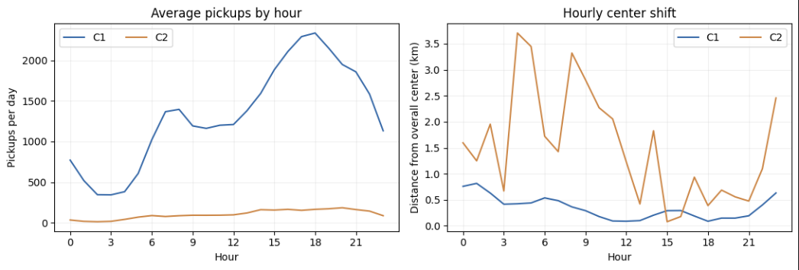
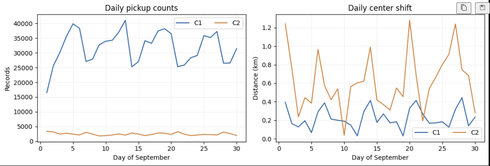
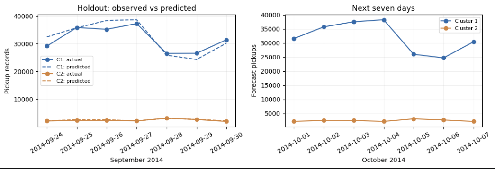

# Uber Pickups: Clustering and Forecasting

**Unsupervised Learning — Optional Homework 1**  
Data: Uber pickup records from September 2014.

## Results

| Measure | Result |
| --- | ---: |
| Original records | 1,028,136 |
| Records used after geographic filtering | 1,027,382 |
| Number of clusters | 2 |
| Silhouette score (K = 2) | 0.654 |
| Cluster 1 | 953,346 pickups (92.79%) |
| Cluster 2 | 74,036 pickups (7.21%) |
| Forecast validation (overall WAPE) | 5.5% |
| Estimated pickups, October 1–7, 2014 | 241,831 |

### 1. Choosing the number of clusters

### 2. Pickup locations and cluster centers

### 3. Changes by hour and date

### 4. Forecasting

## Conclusion

I compared K values from 2 to 8 and chose **K = 2** because it had the highest Silhouette score. Most pickup records belong to Cluster 1, so the groups are not balanced. Cluster 1 has its busiest recorded hour at **18:00**, while Cluster 2 peaks at **20:00**. The charts also show that pickup counts and cluster centers change throughout the month.

For forecasting, the selected weekday-average method gave an overall **WAPE of 5.5%** on the last seven days of September. The estimated total for October 1–7 is **241,831 pickups**. I would treat this as a short-term example rather than a precise prediction: the dataset covers only one month, and the test week was also used to compare forecasting methods.

## Files

- `Extra_homework_503221` — analysis and results in Python.
- `uber-data.csv.gz` — compressed dataset used by the notebook.
- `images/` — selected screenshots of the notebook results.
